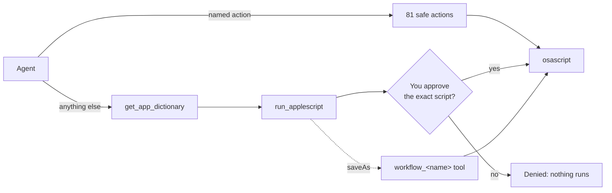

<div align="center">

# mcp-osx

**Let AI agents control your Mac, safely.**

An [MCP](https://modelcontextprotocol.io) server that drives macOS through `osascript`. It has 81 ready-made actions across 19 apps, and the agent can write its own AppleScript when those aren't enough. **Nothing arbitrary runs until you approve the exact script.**

[](https://www.npmjs.com/package/mcp-osx)
[](https://github.com/zaosoula/mcp-osx/actions/workflows/ci.yml)
[](https://registry.modelcontextprotocol.io)

[](LICENSE)

</div>

```text
You:    Switch to dark mode, open GitHub in Safari, pause Spotify and tell me what's on my calendar today.
Agent:  ✓ system_set_dark_mode   ✓ safari_open_url   ✓ spotify_control   ✓ calendar_list_events
        You have 3 meetings today: 10:00 Stand-up, 14:30 Design review, 17:00 1:1 with Sam.
```

## Highlights

- **81 named actions across 19 apps**: system settings, Finder, Safari, Chrome, Brave, Spotify, Music, TV, VLC, QuickTime, Photos, Keynote, Calendar, Reminders, Notes, Contacts, Mail and more. Named actions only read, play, open or create. They never send, delete or run code, so they run without prompting you.
- **Any app with a scripting dictionary**: the agent reads the app's dictionary (`sdef`), writes a script, and you **approve the exact script** in the chat or in a native macOS dialog.
- **Workflows**: an approved script can be saved as a new tool, `workflow_<name>`, so you only approve it once.
- **Small context footprint**: works with tool search (Claude Code defers its 87 tools automatically). A **compact mode** cuts the up-front cost to about 1.2k tokens for clients that load every tool.
- **Typed results**: list actions return `structuredContent` with an `outputSchema`, not just text.
- **Bundled skills**: one teaches agents to write AppleScript that works on the first try, the other gives ready-made routines (focus mode, start of the workday…).
- **Built on MCP SDK v2**: serves both 2025-era and 2026-07-28 protocol clients over stdio.

## Quick start

Requires **macOS 14+** and **Node.js 20+**.

<details open>
<summary><b>Claude Code</b></summary>

```bash
claude mcp add osx -s user -- npx -y mcp-osx
```
</details>

<details>
<summary><b>Claude Desktop</b></summary>

Add to `~/Library/Application Support/Claude/claude_desktop_config.json`:

```json
{
  "mcpServers": {
    "osx": { "command": "npx", "args": ["-y", "mcp-osx"], "env": { "MCP_OSX_MODE": "compact" } }
  }
}
```

Compact mode is recommended for clients that load every tool definition up front.
</details>

<details>
<summary><b>Cursor</b></summary>

Add to `~/.cursor/mcp.json`:

```json
{ "mcpServers": { "osx": { "command": "npx", "args": ["-y", "mcp-osx"], "env": { "MCP_OSX_MODE": "compact" } } } }
```
</details>

<details>
<summary><b>VS Code (Copilot)</b></summary>

```bash
code --add-mcp '{"name":"osx","command":"npx","args":["-y","mcp-osx"]}'
```
</details>

<details>
<summary><b>From source</b></summary>

```bash
git clone https://github.com/zaosoula/mcp-osx && cd mcp-osx
npm install && npm run build
claude mcp add osx -s user -- node "$PWD/dist/index.js"
```
</details>

The first time the server controls an app, macOS asks whether your terminal or MCP client may control it. Click **OK**. See [Permissions](#macos-permissions).

## Things you can ask

| Ask | What happens |
|-----|--------------|
| "Turn on dark mode and set the volume to 30%" | `system_set_dark_mode`, `system_set_volume` |
| "What tabs do I have open in Brave?" | `chromium_list_tabs` (typed list of window, tab, title, url) |
| "Play my favorites on Spotify" | `spotify_play_favorites` (see [Config](#configuration)) |
| "What's on my plate this week?" | Calendar, Reminders and unread mail, using the `macos-routines` skill |
| "Remind me to call the bank tomorrow at 9" | `reminders_create` |
| "Draft an email to Sam about Friday" | `mail_compose_draft`, which opens a draft and never sends |
| "Rename every file on my Desktop to lowercase" | No named action covers it, so the agent writes an AppleScript and **you approve it** |
| "Save that as a workflow called tidy_desktop" | The next time, `workflow_tidy_desktop` runs without asking |

## How it works



Every script the server runs is a **constant**. Inputs from the agent reach it only as `argv` (`on run argv`), never inserted into the script text, so a value like `"; do shell script "rm -rf ~` stays a plain string.

### Approvals

`run_applescript`, deleting a workflow, and running a workflow whose file was edited all need your approval:

1. **In the chat**, if your client supports elicitation. The tool returns an MCP `input_required` result showing the full script. The round-trip state is HMAC-signed and tied to a hash of exactly what you saw, so an approval can't be reused for a different script.
2. **In a native macOS dialog** otherwise. It shows the full, scrollable script. **Deny** is the default button, and the dialog denies automatically after 120 seconds.

Anything else, such as an error, a timeout or a closed dialog, counts as **deny**.

### Workflows

```jsonc
// run_applescript arguments
{
  "script": "on run argv\n  tell application \"Safari\" to open location (\"https://github.com/\" & item 1 of argv)\nend run",
  "args": ["anthropics"],
  "saveAs": "open_github",
  "description": "Open a GitHub org or repo",
  "params": [{ "name": "path", "required": true }]
}
```

After you approve, `workflow_open_github({ path })` is a new tool and runs without asking. The approval prompt warns you that later runs may pass **any value** for the declared params. Workflows are stored as readable JSON in `~/.mcp-osx/workflows/`. Each one holds a SHA-256 hash of the approved script, and if the file is edited the next run asks you again.

### Discover any app

```text
list_scriptable_apps                 → every installed app that ships a scripting dictionary
get_app_dictionary("Music", "track") → compact summary of its commands, classes and properties
```

The summaries are compact: Spotify's 7 KB `sdef` becomes about 1.2 KB. They also include Apple's standard suites that `sdef` leaves out, and they parse the Keynote, Pages and Numbers dictionaries.

## Tools

| Group | What it covers |
|-------|----------------|
| `system` | dark mode, volume, mute, Wi-Fi, clipboard, speech, notifications, screensaver, display sleep, battery, system info |
| `settings` | open any System Settings pane |
| `app` | open, activate, quit, list running, frontmost |
| `finder` | reveal, open folder, selection, front window path, list a folder |
| `safari` · `chromium` | open URLs, list and switch tabs, current tab, web search, Reading List, reload, back/forward (Chrome and Brave) |
| `spotify` · `music` · `tv` · `vlc` · `quicktime` | playback, now playing, playlists, shuffle, stream URLs |
| `photos` · `keynote` | albums, slideshows, presentation control |
| `calendar` · `reminders` · `notes` · `contacts` | list, read and search; create events, reminders and notes (never with attendees) |
| `mail` | accounts, unread count, list/read messages, check mail, **draft (never sends)** |
| `lookaway` | break-reminder control |

**Always available:** `run_applescript`, `list_scriptable_apps`, `get_app_dictionary`, `list_workflows`, `run_workflow`, `delete_workflow`, and `search_actions` / `run_action` in compact mode.

**Deliberately missing:** anything that sends (Mail, Messages), deletes, empties, erases, runs code (browser JavaScript, Terminal `do script`, Shortcuts), writes files, or records. The agent can still do these through `run_applescript`, which asks you first. A test enforces this rule for every named action, and an `osacompile` test checks that every action script compiles.

### Full reference

<!-- tools:start -->
_81 named actions, generated from the source by `npm run docs`._

<details>
<summary><b>system</b> — 15 actions</summary>

| Tool | Args | Description |
|---|---|---|
| `system_get_dark_mode` | — | Return "true" if macOS dark mode is on, else "false". |
| `system_set_dark_mode` | `enabled` | Turn macOS dark mode on or off. |
| `system_get_volume` | — | Return the output volume and mute state. Returns tab-separated: volume (0-100), muted (true/false). |
| `system_set_volume` | `level` | Set output volume (0-100). |
| `system_set_muted` | `muted` | Mute or unmute audio output. |
| `system_wifi_status` | — | Return Wi-Fi power state. |
| `system_set_wifi` | `enabled` | Turn Wi-Fi on or off. Warning: turning it off may cut the agent's own network connection. |
| `system_notify` | `title`, `message` | Show a macOS notification. |
| `system_get_clipboard` | — | Return the clipboard as plain text (truncated to 10000 chars); non-text clipboards are reported, not returned. |
| `system_set_clipboard` | `text` | Replace the clipboard contents with the given text. |
| `system_say` | `text`, `voice?` | Speak text aloud with macOS text-to-speech (waits until done); optional voice name. |
| `system_start_screensaver` | — | Start the current screen saver. |
| `system_sleep_display` | — | Put the display(s) to sleep now (pmset displaysleepnow); the Mac stays awake. |
| `system_battery_status` | — | Return battery charge, power source and charging state (pmset -g batt). |
| `system_info` | — | Return computer name, macOS version, user, CPU, memory and uptime. Returns tab-separated key, value lines (keys: computer, macos, user, cpu, memory_mb, uptime). |

</details>

<details>
<summary><b>settings</b> — 2 actions</summary>

| Tool | Args | Description |
|---|---|---|
| `settings_open_pane` | `pane` | Open a System Settings pane (visible window; changes nothing). See settings_list_panes. |
| `settings_list_panes` | — | List the pane names accepted by settings_open_pane, one per line. Returns: pane. |

</details>

<details>
<summary><b>app</b> — 5 actions</summary>

| Tool | Args | Description |
|---|---|---|
| `app_open` | `name` | Launch (or bring forward) an application by name. |
| `app_activate` | `name` | Bring a running application to the front. |
| `app_quit` | `name` | Quit an application normally (it may ask to save unsaved work). |
| `app_list_running` | — | List visible running applications, one name per line. Returns: name. |
| `app_frontmost` | — | Return the name of the frontmost application. |

</details>

<details>
<summary><b>finder</b> — 5 actions</summary>

| Tool | Args | Description |
|---|---|---|
| `finder_reveal` | `path` | Reveal (select) a file or folder in Finder and bring Finder to the front. |
| `finder_open_folder` | `path` | Open a folder in a new Finder window and bring Finder to the front; errors if the path is missing or not a folder. |
| `finder_selection` | — | Return the POSIX paths of the items selected in Finder, one per line (max 200). |
| `finder_front_window_path` | — | Return the POSIX path of the folder shown in the frontmost Finder window. |
| `finder_list_folder` | `path`, `limit?` | List visible items in a folder, one per line (default 50, max 200). Read-only. Returns tab-separated: name, kind (folder/package/file). |

</details>

<details>
<summary><b>safari</b> — 6 actions</summary>

| Tool | Args | Description |
|---|---|---|
| `safari_open_url` | `url`, `newWindow?` | Open a URL in Safari (new tab in the front window by default). |
| `safari_current_tab` | — | Return the current Safari tab. Returns tab-separated: url, title. |
| `safari_list_tabs` | `limit?` | List open Safari tabs, one per line. Returns tab-separated: window, tab (indexes), current ("*" if current tab, else empty), title, url (cut at 300 chars). |
| `safari_activate_tab` | `window`, `tab` | Bring a Safari tab to the front by window and tab index (from safari_list_tabs); returns its title. |
| `safari_search_web` | `query` | Search the web with Safari's current search provider, in a new tab (launches Safari if needed). |
| `safari_add_reading_list` | `url`, `title?` | Add an http(s) URL (optional title) to the Safari Reading List; launches Safari if needed. |

</details>

<details>
<summary><b>chromium</b> — 6 actions</summary>

| Tool | Args | Description |
|---|---|---|
| `chromium_open_url` | `url`, `newWindow?`, `browser?` | Open an http(s) URL in Chrome or Brave (new tab in the front window by default); launches the browser if needed. |
| `chromium_list_tabs` | `browser?`, `limit?` | List open Chrome/Brave tabs, one per line. Returns tab-separated: window, tab (indexes), active ("*" if active tab, else empty), title, url (cut at 300 chars). |
| `chromium_current_tab` | `browser?` | Return the active tab of the front Chrome/Brave window. Returns tab-separated: url, title. |
| `chromium_activate_tab` | `window`, `tab`, `browser?` | Bring a Chrome/Brave tab to the front by window and tab index (from chromium_list_tabs); returns its title. |
| `chromium_reload` | `browser?` | Reload the active tab in the front Chrome/Brave window. |
| `chromium_go` | `direction`, `browser?` | Go back or forward in the active tab of the front Chrome/Brave window. |

</details>

<details>
<summary><b>spotify</b> — 4 actions</summary>

| Tool | Args | Description |
|---|---|---|
| `spotify_control` | `command` | Control Spotify playback: play, pause or resume the song, skip to the next or previous track. |
| `spotify_current_track` | — | Return the current Spotify track. Returns tab-separated: name, artist, album, state (playing/paused), url (spotify: URI); "stopped" when nothing plays. |
| `spotify_play` | `uri` | Play a Spotify track, album or playlist by URI. |
| `spotify_play_favorites` | — | Play the favorites playlist configured as spotify.favorites in ~/.mcp-osx/config.json. |

</details>

<details>
<summary><b>music</b> — 7 actions</summary>

| Tool | Args | Description |
|---|---|---|
| `music_control` | `command` | Control Apple Music playback: play, pause or resume the song, skip to the next or previous track, stop; returns the player state. play/playpause may launch Music. |
| `music_current_track` | — | Return the current Music track. Returns tab-separated: name, artist, album, position_s, duration_s (whole seconds), state (playing/paused/…); "stopped" when nothing plays. |
| `music_list_playlists` | `limit?` | List Music playlists, one per line (default 20, max 200). Returns tab-separated: name, track_count. |
| `music_play_playlist` | `name` | Play a Music playlist by exact name (launches Music if needed). |
| `music_search_play` | `query` | Search the Music library and play the first matching track; returns what is playing (launches Music if needed). |
| `music_set_shuffle` | `enabled` | Turn Music shuffle on or off; returns the new setting. |
| `music_set_volume` | `level` | Set Music's own sound volume (0-100, not the system volume); returns the new level. |

</details>

<details>
<summary><b>tv</b> — 2 actions</summary>

| Tool | Args | Description |
|---|---|---|
| `tv_control` | `command` | Control TV app playback (play, pause, playpause, next, previous, stop); returns the player state. play/playpause may launch TV. |
| `tv_current` | — | Return what the TV app is playing. Returns tab-separated: name, show (empty for movies), position_s, duration_s (whole seconds), state; "stopped" when nothing plays. |

</details>

<details>
<summary><b>vlc</b> — 3 actions</summary>

| Tool | Args | Description |
|---|---|---|
| `vlc_control` | `command` | Control VLC: play (toggles play/pause; may launch VLC), stop, next, previous, mute (toggle), fullscreen (toggle), volume_up/down, step_forward/backward. |
| `vlc_now_playing` | — | Return the current VLC item. Returns tab-separated: name, position_s, duration_s (seconds), playing (true/false). |
| `vlc_open_url` | `url` | Open a media stream URL (http, https, rtsp, rtmp) in VLC and start playing it; launches VLC if needed. |

</details>

<details>
<summary><b>quicktime</b> — 2 actions</summary>

| Tool | Args | Description |
|---|---|---|
| `quicktime_control` | `command` | Control playback of the front QuickTime Player document: play, pause, stop, step_forward, step_backward; returns its name, position and playing state. |
| `quicktime_open_url` | `url` | Open an http(s) media URL in QuickTime Player (opens a visible player window). |

</details>

<details>
<summary><b>photos</b> — 2 actions</summary>

| Tool | Args | Description |
|---|---|---|
| `photos_list_albums` | `limit?` | List Photos albums, one per line (default 20, max 200). Returns tab-separated: name, item_count. |
| `photos_slideshow` | `command`, `album?` | Control a Photos slideshow: start (needs album; launches Photos, full screen), stop, next, previous, pause, resume. |

</details>

<details>
<summary><b>keynote</b> — 2 actions</summary>

| Tool | Args | Description |
|---|---|---|
| `keynote_slideshow` | `command` | Control the Keynote slideshow of the front document: start (full screen), stop, next, previous. |
| `keynote_list_documents` | — | List open Keynote documents, one per line. Returns tab-separated: name, slide_count, modified (true if unsaved changes). |

</details>

<details>
<summary><b>calendar</b> — 4 actions</summary>

| Tool | Args | Description |
|---|---|---|
| `calendar_list_calendars` | — | List Calendar calendars, one per line. Returns tab-separated: name, writable (true/false). |
| `calendar_list_events` | `from?`, `to?`, `calendar?`, `limit?` | List Calendar events starting in a range (default today to 7 days ahead), sorted by start. Returns tab-separated: start, end (YYYY-MM-DD HH:MM), summary, location, calendar. Recurring events show only their first occurrence. |
| `calendar_create_event` | `title`, `start`, `end`, `calendar?`, `location?`, `notes?` | Create a Calendar event (no attendees, no invitations sent). Returns tab-separated: summary, start, end, calendar. Example: {"title":"Dentist","start":"2026-11-12T14:30","end":"2026-11-12T15:15","calendar":"Personnel","location":"12 rue X"} |
| `calendar_show_date` | `date`, `view?` | Bring Calendar to the front and show the given date, optionally in day, week or month view. |

</details>

<details>
<summary><b>reminders</b> — 4 actions</summary>

| Tool | Args | Description |
|---|---|---|
| `reminders_list_lists` | — | List Reminders lists, one per line. Returns tab-separated: account, list. |
| `reminders_list` | `list?`, `includeCompleted?`, `limit?` | List reminders (incomplete only by default), one per line. Returns tab-separated: name, due (YYYY-MM-DD HH:MM or empty), list, completed (true/false). |
| `reminders_create` | `title`, `list?`, `due?`, `notes?` | Create a reminder (in the default list unless one is given). Returns tab-separated: name, due, list. |
| `reminders_complete` | `list`, `title` | Mark the first incomplete reminder with this exact name in the given list as completed (reversible). |

</details>

<details>
<summary><b>notes</b> — 4 actions</summary>

| Tool | Args | Description |
|---|---|---|
| `notes_list_folders` | — | List Notes folders, one per line. Returns tab-separated: account, folder, note_count. |
| `notes_list` | `folder?`, `limit?` | List notes (optionally in one folder), one per line. Returns tab-separated: name, modified (YYYY-MM-DD HH:MM). |
| `notes_read` | `name`, `folder?` | Return a note's name, modification date, folder and plaintext (truncated to 4000 chars). |
| `notes_create` | `title`, `body`, `folder?` | Create a note from a title and plain-text body (in the default folder unless one is given); returns its name. |

</details>

<details>
<summary><b>contacts</b> — 1 action</summary>

| Tool | Args | Description |
|---|---|---|
| `contacts_search` | `query`, `limit?` | Search Contacts by name or organization (read-only), one per line. Returns tab-separated: name, emails, phones (comma-separated), organization. |

</details>

<details>
<summary><b>mail</b> — 6 actions</summary>

| Tool | Args | Description |
|---|---|---|
| `mail_list_accounts` | — | List Mail accounts, one per line (requires Mail running). Returns tab-separated: name, type, enabled (true/false), email_addresses (comma-separated). |
| `mail_unread_count` | `account?` | Return the unread count of the unified inbox, or of one account's INBOX (requires Mail running). |
| `mail_list_messages` | `mailbox?`, `account?`, `limit?`, `unreadOnly?` | List recent messages in a mailbox (default inbox), one per line (requires Mail running). Returns tab-separated: date (YYYY-MM-DD HH:MM), sender, subject, read_status (read/unread), id (for mail_read_message). |
| `mail_read_message` | `id` | Return a message's headers and plain-text content (truncated to 4000 chars) by id from mail_list_messages (requires Mail running). |
| `mail_check_new` | — | Ask Mail to check all accounts for new mail (requires Mail running). |
| `mail_compose_draft` | `to?`, `cc?`, `subject?`, `body?` | Open a VISIBLE new-message window in Mail prefilled with to/cc/subject/body; does NOT send (the user reviews and sends). |

</details>

<details>
<summary><b>lookaway</b> — 1 action</summary>

| Tool | Args | Description |
|---|---|---|
| `lookaway_control` | `command`, `seconds?`, `message?` | Control LookAway: start/stop it, reset timers, start a (next/long/custom) break, pause, pause temporarily, postpone the break, resume. |

</details>
<!-- tools:end -->

## Typed results

List and "current item" actions declare an `outputSchema` and return `structuredContent`:

```json
{ "items": [{ "window": "1", "tab": "2", "active": "*", "title": "Docs", "url": "https://…" }],
  "notes": ["… 35 more tabs not shown"] }
```

`notes` holds lines that aren't records, such as truncation notices or "Safari is not running".

## Skills

The server publishes two [MCP skills](https://ts.sdk.modelcontextprotocol.io/v2/). The client loads them only when needed:

- **`applescript-authoring`**: how to script an app with no named action. It covers reading the dictionary, passing inputs through argv, getting approval and saving a workflow, with a reference of common AppleScript errors and their fixes.
- **`macos-routines`**: focus mode, presentation mode, start of the workday, end of day, and "what's on my plate", built from named actions.

## Context size

Every MCP tool definition takes up context.

| Mode | Tools listed | Up-front cost | Use with |
|------|--------------|---------------|----------|
| `full` (default) | 81 actions + 6 core tools | Names only with tool search, otherwise ~11k tokens | Clients with tool search (Claude Code) |
| `compact` | `search_actions`, `run_action` + core | ~1.2k tokens | Clients that load every tool |

In compact mode, `search_actions("pause song")` returns the matching actions with their full JSON input and output schemas, and `run_action` validates the arguments before anything runs.

**Using the Claude API with the MCP connector?** The API caller decides which tools are deferred, not the server. Defer everything except the core tools:

```json
{
  "type": "mcp_toolset",
  "mcp_server_name": "osx",
  "default_config": { "defer_loading": true },
  "configs": { "run_applescript": { "defer_loading": false }, "get_app_dictionary": { "defer_loading": false } }
}
```

Add `tool_search_tool_bm25_20251119` to the same request. Tool names are prefixed by app and descriptions use everyday task words, so searches like "spotify" or "calendar event" find the right tools.

## Configuration

| Variable | Default | Meaning |
|----------|---------|---------|
| `MCP_OSX_MODE` | `full` | `compact` lists only `search_actions` / `run_action` plus the core tools |
| `MCP_OSX_APPS` | all | Comma-separated groups to expose, e.g. `system,app,safari,spotify,calendar`. A typo stops the server at startup with the list of valid groups. |
| `MCP_OSX_HOME` | `~/.mcp-osx` | Data directory for `config.json` and `workflows/` |

`~/.mcp-osx/config.json`:

```json
{ "spotify": { "favorites": "spotify:playlist:37i9dQZF1DXcBWIGoYBM5M" } }
```

Spotify's AppleScript interface can't read your library, so `spotify_play_favorites` plays this URI. To get it, right-click a playlist in Spotify and choose **Share › Copy link**.

## macOS permissions

| Permission | When | Where |
|------------|------|-------|
| **Automation** | The first time each app is controlled (error `-1743` if refused) | System Settings › Privacy & Security › Automation |
| **Accessibility** | Only for scripts that click UI through System Events (error `-25211`) | System Settings › Privacy & Security › Accessibility |
| **Calendars / Reminders / Contacts** | The first time those apps are read | macOS asks you |

Permissions apply to the **host process**, i.e. your terminal or MCP client, not to `mcp-osx` itself.

## Security model

- Named actions are non-destructive, use constant scripts, and receive input only through argv.
- Arbitrary code runs only after you approve that exact script. Approvals fail closed, and chat approvals are cryptographically tied to what you were shown.
- The workflow hash catches **accidental or out-of-band edits**. It does **not** protect against a malicious agent that can write files, which could edit a workflow and recompute its hash.
- More generally, any agent with shell access can run `osascript` itself. This server only controls access through its own interface.

## Troubleshooting

| Symptom | Fix |
|---------|-----|
| A call hangs for 30 s, then times out | macOS is probably waiting for you to answer an Automation prompt. Look for it, or check System Settings › Privacy & Security › Automation. |
| `Not authorized to send Apple events (-1743)` | Allow your terminal or MCP client under Automation |
| `calendar_list_events` is slow | Calendar's AppleScript is slow on large calendars (it has up to 2 minutes). Pass `calendar` to query one calendar. |
| `spotify_play_favorites` errors | Set `spotify.favorites`; see [Configuration](#configuration) |
| Tools missing in the client | Check `MCP_OSX_APPS`, and restart the client after installing |

## Development

```bash
npm install
npm test          # vitest: safety, compile, approval, search and server tests (macOS)
npm run docs      # regenerate the tool reference above
npm run build
```

**Adding an app:** create `src/actions/<group>.ts`, prefix every action with `<group>_`, register it in `actionGroups` (`src/actions/index.ts`), and run `npm test && npm run docs`. The tests reject scripts that insert inputs into the script text, use destructive commands, or don't compile.

## License

[MIT](LICENSE) © Zao Soula
